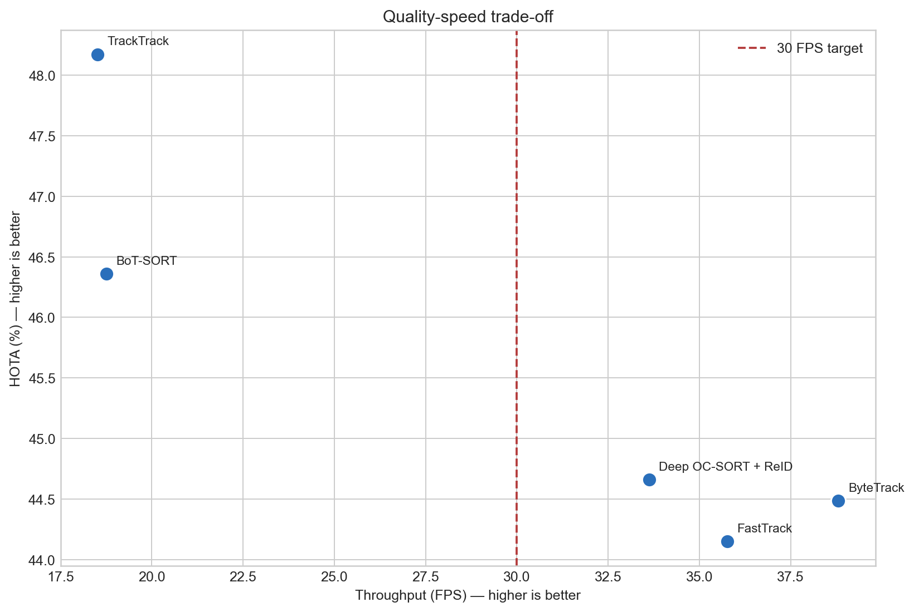

# Multi-Object Tracking (MOT) Algorithm Benchmark

A controlled, empirical comparison of 5 MOT algorithms (ByteTrack, BoT-SORT, TrackTrack, Deep OC-SORT, FastTracker) under a fixed YOLOv8 detection pipeline.  

Paper: [PDF](paper/mot-tracker-comparison.pdf)

| Tracker | HOTA (%) | IDF1 (%) | Throughput (FPS) |
|---|---:|---:|---:|
| **TrackTrack** | **48.17** | **58.08** | 18.51 |
| **ByteTrack** | 44.48 | 50.69 | **38.81** |



## Key finding

**TrackTrack produced the strongest overall tracking quality and identity stability. ByteTrack offered the best balance between quality and speed for a 30 FPS laptop deployment.** TrackTrack reached 48.17% HOTA and 58.08% IDF1, while ByteTrack was over twice as fast at 38.81 FPS.

## Experimental setup

| Component | Configuration |
|---|---|
| Detector | YOLOv8 large |
| Dataset | MOT17-09 pedestrian sequence |
| Input | 525 frames, 1920x1080 at 30 FPS |
| Class filter | COCO person class only |
| Detection threshold | 0.10 |
| Inference size | 640 pixels |
| Hardware | NVIDIA GeForce RTX 5060 Laptop GPU |
| Evaluation | HOTA, DetA, AssA, IDF1, MOTA, ID switches, fragments, precision, recall, latency, and FPS |
| Protocol | Fresh model and tracker state per run. First five timing samples excluded (5 warmup frames for CUDA kernel) |

The detector, input sequence, preprocessing, confidence threshold, class filter, and evaluation code were held constant. Only the tracking configuration changed between runs.

## Trackers evaluated

- **ByteTrack** performs a second association pass using lower-confidence detections, recovering partially occluded pedestrians without an appearance model.
- **BoT-SORT** combines motion, confidence, and camera-motion compensation. Re-identification was disabled in this experiment.
- **TrackTrack** uses track-perspective association and track-aware initialization to preserve established trajectories and suppress unnecessary new tracks.
- **Deep OC-SORT + ReID** combines observation-centric motion correction with adaptively weighted appearance features for identity recovery after occlusion.
- **FastTracker** adds occlusion-aware track retention and recovery to a lightweight ByteTrack-style association pipeline. The experiment configuration and saved artifacts use the tracker project's `FastTrack` identifier.

## Results

| Tracker | HOTA (%) | IDF1 (%) | AssA (%) | ID switches | Fragments | Median latency (ms) | FPS |
|---|---:|---:|---:|---:|---:|---:|---:|
| ByteTrack | 44.48 | 50.69 | 40.70 | 43 | 61 | **25.26** | **38.81** |
| BoT-SORT | 46.36 | 54.05 | 42.70 | 45 | 57 | 53.18 | 18.76 |
| **TrackTrack** | **48.17** | **58.08** | **44.30** | **29** | **49** | 53.69 | 18.51 |
| Deep OC-SORT + ReID | 44.66 | 52.87 | 40.79 | 47 | 62 | 29.12 | 33.63 |
| FastTracker | 44.15 | 51.78 | 40.51 | 56 | 59 | 27.54 | 35.76 |

The complete machine-readable result is available in [`tracker_comparison.csv`](evaluation/results/tracker_comparison.csv). Tracking metrics were recomputed from the saved frame-level predictions using one shared local evaluator.

## Qualitative example


This animation demonstrates persistent identities and detections over time. It is illustrative only; the full-sequence metrics above, rather than a selected clip, determine the comparison.

## Reproducing the experiment

The experiment was executed with Python 3.13. CUDA is optional, but hardware and PyTorch builds materially affect the reported latency and throughput. Install the appropriate PyTorch build for your platform before installing the remaining dependencies.

```powershell
python -m venv .venv
.\.venv\Scripts\Activate.ps1
python -m pip install -r requirements.txt
```

The pretrained `yolov8l.pt` checkpoint is not committed. Download it separately and place it in the repository root. The MOT17-09 video is also not redistributed; place the sequence at the path expected by the experiment:

```text
evaluation/stationary_webcam_eval.mp4
```

The matching pedestrian ground truth is provided at `evaluation/ground_truth.txt`. Run either the script or the executed notebook:

```powershell
python experiment.py
# or
jupyter notebook experiment.ipynb
```

Both entry points regenerate frame-level prediction CSVs, annotated videos, and `evaluation/results/tracker_comparison.csv`; the notebook also regenerates the figures. Large generated artifacts remain ignored by Git.

## Limitations

- The study uses one short, stationary-camera MOT17-09 sequence and one laptop environment.
- The local evaluator does not reproduce official MOTChallenge distractor and ignore-region handling, so these are controlled relative results rather than official leaderboard scores.
- Each tracker was timed once; repeated runs would better characterize runtime variance.
- Timing includes frame capture, preprocessing, detection, tracking, and result transfer, but excludes rendering and video encoding.
- Tracker behavior depends on the installed Ultralytics implementations and their configuration defaults.

## Citation

```bibtex
@misc{loke2026mot,
  author = {Jerome Loke},
  title = {Comparing Multi-Object Tracking Algorithms for Stable Real-Time YOLOv8 Tracking},
  year = {2026},
  url = {https://github.com/lokejer/MOT-algo-benchmark},
  note = {Technical report and reproducible implementation}
}
```
